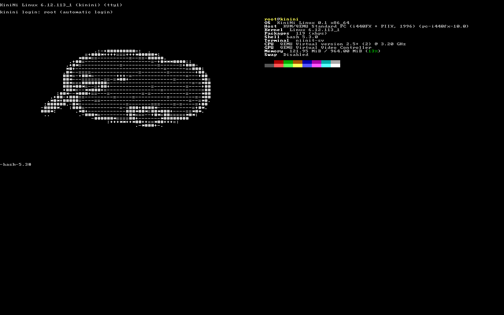

<p align="center">
  
</p>

<h1 align="center">KiniNi Linux</h1>

<p align="center">
  A tiny glibc distribution built on Void Linux binary packages,<br>
  with its own runit-like init (<b>niinit</b>) and XBPS-based package manager (<b>kipki</b>).
</p>

<p align="center">
  <a href="https://github.com/mel0k1/KiniNi/actions/workflows/ci.yml"></a>
  <a href="LICENSE"></a>
  
  
</p>

---

## About

KiniNi is a small, opinionated Linux distribution that does not reinvent the
package ecosystem. Instead of maintaining its own repositories, it consumes
the upstream Void Linux binary repositories directly — a glibc system with
access to thousands of ready-to-install packages, no compilation required.
Every tool the user touches, however, is KiniNi's own.

The distribution is assembled by `tools/mkrootfs.sh`: it bootstraps a
`base-system` rootfs from Void mirrors, layers the KiniNi identity on top
(`os-release`, hostname, motd-ready skel), and installs the native components.
The result is a minimal, fully supervised system where the init, the package
manager, and even the terminal greeting bird are first-party code.

The name and the mascot come from the kiwi: small, nocturnal, unassuming —
and surprisingly resilient. The ASCII bird greets you on every console via
`fastfetch` (and works with any fetch tool that accepts a custom file).

## Components

| Component | What it is | Language |
|-----------|------------|----------|
| **niinit** | PID 1: three-stage boot (like runit), orphan reaping, reboot/poweroff/halt signaling | C99 |
| **niinit-sv** | Per-service supervisor: restart on crash, `finish` scripts, `down` files, runit-compatible control FIFO (`u d o t k p c h a i q 1 2 x`), `stat`/`pid` files | C99 |
| **niinit-svdir** | Watches `/etc/niinit/services`, spawns/stops supervisors as dirs appear/vanish | C99 |
| **svctl** | `status` (with uptime) / `up` / `down` / `start` / `stop` / `restart` / `once` / `pause` / `cont` / signals / `check` / `enable` / `disable`; doubles as `reboot`/`poweroff`/`halt` | C99 |
| **kipki** | Package manager on libxbps: transactions, search, orphans, holds, local log | C + libxbps |
| **mkrootfs** | Builds a rootfs from Void repositories | POSIX sh |
| **mkiso** | Builds a bootable live ISO: kernel, initramfs, isolinux + grub-efi (BIOS **and** UEFI), overlayfs root, disk installer on board | POSIX sh |
| **kiwi-install** | Disk installer: partitions (msdos/GPT), copies the live system, swap partition, fstab, offline extlinux (BIOS) or grub-on-ESP (UEFI) bootloader | POSIX sh |
| **kinini-settings** | CachyOS-inspired tuning shipped in the skel: sysctl.d profile, per-device IO-scheduler udev rules, zram swap, watchdog blacklists | conf/sh |

## Quick start

Building requires `gcc`, `make`, `pkg-config`, and `libxbps-devel` (Void) or
`libarchive` + `libxbps` headers elsewhere:

```sh
git clone https://github.com/mel0k1/KiniNi.git
cd KiniNi
make
```

Build a rootfs (run on Void Linux or inside `voidlinux/voidlinux`, as root):

```sh
./tools/mkrootfs.sh /mnt/kinini
# custom mirror:
./tools/mkrootfs.sh /mnt/kinini https://mirror.example.org/voidlinux/current
```

The script produces a complete tree: `base-system` packages, `niinit` as the
init, `kipki` as the package manager, getty services on tty1–tty6, and the
kiwi mascot in place for `fastfetch`.

## Live ISO

`tools/mkiso.sh` turns a rootfs into a bootable hybrid ISO — Linux kernel
6.12, a busybox initramfs that finds the medium and mounts an overlayfs root
(all writes go to a tmpfs layer, the medium stays untouched), isolinux for
BIOS and a standalone grub `x86_64-efi` on an appended FAT ESP for UEFI
(same `grub-mkrescue`-style image boots CDs and USB sticks on both firmware
types):

```sh
# rootfs with a kernel and fastfetch (linux metapackage is skipped,
# the LTS kernel series is pinned explicitly):
IGNORE_PKGS=linux ./tools/mkrootfs.sh /tmp/rootfs \
        https://repo-default.voidlinux.org/current base-system linux6.12 fastfetch

./tools/mkiso.sh /tmp/rootfs kinini-0.3-x86_64.iso
```

Test it in qemu (BIOS or OVMF/UEFI — the same image):

```sh
qemu-system-x86_64 -m 1024 -cdrom kinini-0.3-x86_64.iso -boot d
qemu-system-x86_64 -m 1024 -cdrom kinini-0.3-x86_64.iso -bios OVMF.fd
```

The live session autologs in on tty1 and ttyS0, brings the network up via
DHCP (`dhcpcd` service, enabled on the live image) and greets you with the
bird:

<p align="center">
  
</p>

## Package management with kipki

`kipki` speaks to Void repositories through libxbps and adds a compact,
colored CLI on top — transaction preview, repository sync, orphan handling,
holds and a local transaction log:

```sh
kipki sync                  # refresh repository indexes
kipki install vim git       # resolve + preview + commit (i, add)
kipki upgrade               # update everything (up)
kipki remove vim            # remove (rm, del)
kipki autoremove            # drop orphans (auto)
kipki search terminal       # search name and description (se)
kipki info vim              # full package card
kipki list                  # installed packages (ls)
kipki files vim             # file list of an installed package
kipki owns /usr/bin/vim     # which package owns this file
kipki deps vim -f           # dependencies, -f for the full tree
kipki revdeps glibc         # what depends on it
kipki hold linux            # pin a package (unhold, held)
kipki clean                 # clear the package cache
kipki log                   # local transaction history
```

Operations on a foreign root: `kipki -r /mnt/kinini install vim`.

## Services with niinit

A service is a directory in `/etc/niinit/services` with an executable `run`
script. The supervisor restarts it if it dies, `svctl` talks to it through a
control FIFO:

```sh
# /etc/niinit/services/getty-tty1/run
#!/bin/sh
exec agetty --noclear -L tty1 38400 linux
```

Nothing is enabled behind the user's back: services live in
`/etc/niinit/services-available` until you link them in. `sshd` and `dhcpcd`
ship there as optional services — disabled by default in installed systems
(the live ISO turns DHCP on for you):

```sh
svctl enable sshd       # symlink from services-available, svdir picks it up in <=5s
svctl start sshd        # waits until it is actually up
svctl enable dhcpcd     # DHCP on wired interfaces (runs dhcpcd -B -M, foreground)
```

`svctl enable/disable` manage those symlinks for you; the supervisor honors
runit conventions: a `down` file in a service dir prevents auto-start at
boot, and a `finish` script runs after each service exit with the exit code
and terminating signal as arguments.

```sh
svctl status               # overview with pid and uptime
svctl restart sshd         # up / down / start / stop / restart / once
svctl pause sshd           # SIGSTOP / SIGCONT (cont)
hup, alarm, int, quit, usr1, usr2, term  # raw signals to the service
svctl check sshd           # exit 0 only if up (waits up to -w SEC)
reboot                     # svctl in disguise: signals PID 1
poweroff                   # same story
halt                       # and even that
```

The boot itself is three stages, exactly like runit: `/etc/niinit/1` mounts
pseudo-filesystems and brings up udev and loopback, stage 2 supervises
services until shutdown, and `/etc/niinit/3` unmounts everything back.
PID 1 gives every process a grace period to exit on TERM before the final
KILL, then runs stage 3.

## Installing to disk

The live ISO ships a complete installer. Boot the ISO (BIOS or UEFI — the
installer autodetects the firmware via `/sys/firmware/efi/efivars`) and run
as root:

```sh
kiwi-install -d /dev/sda -y              # BIOS: msdos + extlinux
kiwi-install -d /dev/nvme0n1 -y          # UEFI (autodetected): GPT + ESP + grub
kiwi-install -d /dev/sda -b uefi -y      # force UEFI layout on a BIOS boot
kiwi-install -d /dev/sda -s 0 -N -y      # no swap partition, no DHCP
```

It partitions the disk, creates a swap partition (default `min(2×RAM, 4 GiB)`,
`-s` to change) and an ext4 root, copies the live system, restores the
standard gettys (no autologin on a real install), enables the `dhcpcd`
service (unless `-N`), writes an `/etc/fstab` and installs a bootloader —
all offline, from binaries shipped inside the ISO:

- **BIOS**: msdos label, extlinux + syslinux MBR;
- **UEFI**: GPT with a 512 MiB ESP, and the standalone grub `x86_64-efi`
  binary copied to `\EFI\BOOT\BOOTX64.EFI` — the removable-drive fallback
  path that boots on any UEFI machine without touching NVRAM. The loader
  locates the root filesystem by the `/.kinini-live` marker and reads
  `/boot/grub/grub.cfg` from it.

zram swap is configured in addition to the swap partition (see below). The
root password stays `kinini` until you change it (`passwd`). Without `-y`
the installer lists disks, asks for confirmation and offers to set the root
password interactively. After it finishes, remove the medium and reboot
straight into the installed system.

Both firmware paths are verified in CI on every push: qemu boots the ISO,
installs it to a virtio disk, reboots from disk and checks login, DHCP
lease, zram and the tuning — over the serial console, for BIOS and OVMF
UEFI alike.

## System tuning (CachyOS-inspired)

KiniNi is not a bare-bones base: the skel ships a tuned profile ported from
[CachyOS-Settings](https://github.com/CachyOS/CachyOS-Settings), applied at
boot by `/etc/niinit/1`:

- **sysctl** (`/usr/lib/sysctl.d/70-kinini-settings.conf`): zram-friendly
  `vm.swappiness=100` (150 while zram is active), `vfs_cache_pressure=50`,
  absolute dirty-page limits, `page-cluster=0`, big `max_map_count`, quiet
  console (`printk 3 3 3 3`), NMI watchdog off, larger socket/backlog
  buffers and **BBR congestion control with fq pacing**;
- **zram swap** (`/usr/bin/zram-swap` + `/etc/kinini/zram.conf`):
  `min(RAM, 32 GiB)` of zstd-compressed swap at priority 100 by default,
  zswap disabled while zram runs — same reasoning as CachyOS;
- **IO schedulers** (`66-kinini-iosched.rules`): `bfq` for HDDs,
  `mq-deadline` for SATA/USB SSDs and eMMC, `kyber` for NVMe;
- **watchdog blacklists** (`kinini-watchdog.conf`): iTCO/sp5100/wdat off —
  less power, one less module at boot;
- **amdgpu si/cik** support (`kinini-amdgpu.conf`) for GCN 1/2 Radeons;
- **transparent hugepage defrag** set to `defer+madvise` at boot.

Everything is a plain config file under `/etc` or `/usr/lib` — edit
`/etc/sysctl.d/*.conf` or `/etc/kinini/zram.conf` to override, no tools
required.

## Booting

For a manual install, point any Linux kernel and bootloader (GRUB, syslinux,
EFISTUB) at the rootfs — `/sbin/init` is a symlink to `niinit`, so pass
`root=UUID=... rw` and optionally `init=/sbin/niinit` if you prefer to be
explicit. Or skip the manual assembly entirely and use `kiwi-install` from
the live ISO above.

## CI

Every push runs three Void Linux container jobs: one builds both components
and runs the supervisor test suite (up/down/restart/once, `down` files,
`finish` scripts, crash restart, start/stop/check, enable/disable, signals,
supervisor exit, plus the `svdir` spawn/stop cycle), the second builds a full
rootfs from live Void repositories and verifies the resulting tree byte by
byte, and the third builds the complete live ISO (including a static busybox
compiled from source), then **boots it in qemu — BIOS and OVMF UEFI —
installs to a virtual disk and reboots from the installed system**, checking
login, DHCP, zram and the tuning over the serial console before uploading
the ISO as a workflow artifact.

## Mascot

The kiwi. It lives in `fetch/kiwi.txt`, is installed to
`/usr/share/kinini/kiwi.txt`, and greets every console through the default
`fastfetch` config shipped in the skel.

## License

BSD-2-Clause. See [LICENSE](LICENSE). KiniNi consumes Void Linux binary
packages but contains no Void Linux source code.

---

## Русская версия

**KiniNi** — небольшой дистрибутив Linux на glibc, который не строит
собственную экосистему пакетов, а напрямую использует бинарные репозитории
Void Linux: тысячи готовых пакетов без сборки. При этом всё, с чем работает
пользователь, — собственный код проекта.

**Состав:**

- `niinit` — свой init в стиле runit (три стадии, супервизия сервисов,
  сироты-процессы не остаются); runit-совместимый control-FIFO
  (`u d o t k p c h a i q 1 2 x`), `finish`-скрипты, `down`-файлы;
- `niinit-sv` / `niinit-svdir` / `svctl` — супервизоры и управление:
  рестарт при падении, `svctl status|up|down|start|stop|restart|once|pause|
  cont|hup|usr1|usr2|term|check|enable|disable`, `status` показывает pid и
  uptime, а также `reboot`/`poweroff`/`halt`; PID 1 даёт процессам grace-период
  на корректный выход перед KILL;
- `kipki` — пакетный менеджер на libxbps: транзакции с предпросмотром,
  поиск, сироты, hold, локальный журнал операций;
- `tools/mkrootfs.sh` — сборка корня из репозиториев Void;
- `tools/mkiso.sh` — загрузочный live-ISO: ядро 6.12, initramfs на busybox,
  isolinux (BIOS) и grub x86_64-efi на ESP (UEFI) в одном гибридном образе,
  корень на overlayfs; sshd и dhcpcd лежат в `services-available`, на live
  DHCP включён сразу;
- `tools/kiwi-install` — установщик на диск: разметка (msdos/GPT),
  swap-раздел, копирование live-системы, fstab и загрузчик без сети —
  extlinux (BIOS) или grub на ESP (UEFI, `\EFI\BOOT\BOOTX64.EFI`);
- **tuning** — системные настройки в духе CachyOS: sysctl-профиль
  (swappiness, vfs_cache_pressure, BBR+fq и т.д.), zram-подкачка
  (`zram-swap`, zstd, приоритет 100), udev-правила выбора IO-планировщика
  (bfq/mq-deadline/kyber), блэклисты watchdog'ов, THP `defer+madvise`;
- маскот — птичка киви, ASCII-арт устанавливается в
  `/usr/share/kinini/kiwi.txt` и показывается `fastfetch`.

**Сборка:** `make` (нужны gcc, make, pkg-config, libxbps-devel).

**Rootfs:** `./tools/mkrootfs.sh /mnt/kinini` (на Void или в контейнере
`voidlinux/voidlinux`, от root).

**Live-ISO:** `IGNORE_PKGS=linux ./tools/mkrootfs.sh /tmp/rootfs \
https://repo-default.voidlinux.org/current base-system linux6.12 fastfetch syslinux dhcpcd dosfstools`,
затем `./tools/mkiso.sh /tmp/rootfs kinini.iso`.

**Установка на диск:** загрузите ISO (BIOS или UEFI — установщик
определяет прошивку сам) и выполните:

```sh
kiwi-install -d /dev/nvme0n1 -y    # UEFI: GPT + ESP + grub
kiwi-install -d /dev/sda -y        # BIOS: msdos + extlinux
```

— разметка, swap-раздел (по умолчанию min(2×RAM, 4 ГиБ)), копирование
системы, fstab, DHCP-сервис и загрузчик без сети; оба пути проверяются
в CI на каждый пуш: QEMU грузит ISO, ставит систему на виртуальный диск
и перезагружается с неё (BIOS и OVMF/UEFI), проверяя вход, DHCP, zram
и настройку swappiness по serial-консоли.

**Загрузка:** `/sbin/init` — симлинк на `niinit`, так что достаточно любого
ядра и загрузчика; либо просто установите систему через `kiwi-install`.

**Лицензия:** BSD-2-Clause.
